# Modeling Relationships in Flask-SQLAlchemy

## Overview

EventWise is a RESTful API developed using Flask, Flask-SQLAlchemy, and SQLite to manage conference events, sessions, speakers, and speaker biographies.

This project demonstrates how to establish and query relational database models using SQLAlchemy's Object-Relational Mapper (ORM).

The application was developed as part of the Flask-SQLAlchemy Relationships Lab and focuses on implementing one-to-many, one-to-one, and many-to-many relationships.

The API provides endpoints for retrieving events, viewing their scheduled sessions, identifying speakers, and accessing speaker biographies.

## Features

- **Event Management:** Retrieve conference events and their associated sessions.
- **Session Management:** Retrieve sessions associated with an event or speaker.
- **Speaker Management:** Retrieve all speakers or individual speaker details.
- **Speaker Biographies:** Access biographies through one-to-one relationships.
- **Relational Database Models:** Implement one-to-many, one-to-one, and many-to-many relationships.
- **Association Table:** Connect speakers and sessions using the `session_speakers` table.
- **Association Proxy:** Access speaker names directly from session records.
- **Cascading Deletes:** Automatically remove dependent sessions or biographies when their parent records are deleted.
- **Database Seeding:** Populate the database with sample conference data.
- **Reusable Helper Functions:** Reduce duplicated serialization logic across API endpoints.
- **JSON Responses:** Return structured data for API consumers.
- **Error Handling:** Return appropriate HTTP 404 responses for missing resources.
- **Automated Testing:** Validate models, relationships, and API endpoints using Pytest.

## Technologies Used

- Python
- Flask
- Flask-SQLAlchemy
- SQLAlchemy ORM
- SQLite
- Flask-Migrate
- Alembic
- Pytest
- Pipenv

## Project Structure

```text
flask-sqlalchemy-relationships-lab/
├── server/
│   ├── app.py
│   ├── models.py
│   ├── seed.py
│   ├── instance/
│   │   └── app.db
│   ├── migrations/
│   │   └── versions/
│   └── testing/
├── screenshots/
│   ├── all_events.png
│   ├── database_via_viewer.png
│   ├── event_not_found.png
│   ├── event_sessions.png
│   ├── session_not_found.png
│   ├── session_speakers.png
│   ├── speaker_bio.png
│   ├── speaker_details.png
│   ├── speaker_not_found.png
│   ├── speaker_sessions.png
│   ├── speakers.png
│   └── test_suite.png
├── Pipfile
├── Pipfile.lock
├── .gitignore
└── README.md
```

**Note:** The SQLite database is generated locally. Database files should be excluded from version control using `.gitignore`.

## Installation and Setup

### 1. Clone the Repository

Clone your GitHub repository:

```bash
git clone <https://github.com/Matt20Swanberg/flask-sqlalchemy-relationships-lab>
cd flask-sqlalchemy-relationships-lab
```

### 2. Install Dependencies

Install the project's dependencies:

```bash
pipenv install
```

Activate the virtual environment:

```bash
pipenv shell
```

### 3. Configure Flask

Navigate into the server directory:

```bash
cd server
```

Set the Flask environment variables:

```bash
export FLASK_APP=app.py
export FLASK_RUN_PORT=5555
```

### 4. Apply Database Migrations

Apply the existing database migrations:

```bash
flask db upgrade head
```

This creates or updates the database tables based on the migration history.

**Note:** If the migrations directory already exists, running `flask db init` again is unnecessary.

### 5. Seed the Database

Populate the database with sample conference records:

```bash
python seed.py
```

The seed script creates:

- 2 conference events
- 3 conference sessions
- 3 speakers
- 3 speaker biographies
- 4 speaker-to-session associations

**Important:** Running `seed.py` removes existing application records before inserting the sample data.

### 6. Start the Flask Server

Start the application:

```bash
flask run --port 5555 --debug
```

The API is available at:

```text
http://127.0.0.1:5555
```

## Database Models

The application uses four primary SQLAlchemy models.

### Event Model

Represents a conference event.

| Attribute | Data Type | Description |
|---|---|---|
| id | Integer | Unique primary key |
| name | String | Conference name |
| location | String | Conference location |
| sessions | Relationship | Associated conference sessions |

### Session Model

Represents a scheduled conference session.

| Attribute | Data Type | Description |
|---|---|---|
| id | Integer | Unique primary key |
| title | String | Session title |
| start_time | DateTime | Scheduled session start |
| event_id | Integer | Foreign key referencing Event |
| event | Relationship | Parent event |
| speakers | Relationship | Associated speakers |
| speaker_names | Association Proxy | Names of associated speakers |

### Speaker Model

Represents an individual conference speaker.

| Attribute | Data Type | Description |
|---|---|---|
| id | Integer | Unique primary key |
| name | String | Speaker name |
| bio | Relationship | Associated biography |
| sessions | Relationship | Sessions associated with the speaker |

### Bio Model

Represents a speaker biography.

| Attribute | Data Type | Description |
|---|---|---|
| id | Integer | Unique primary key |
| bio_text | Text | Speaker biography |
| speaker_id | Integer | Unique foreign key referencing Speaker |
| speaker | Relationship | Associated speaker |

## SQLAlchemy Relationships

### One-to-Many: Event and Session

One event can contain multiple sessions, but each session belongs to one event.

Implemented using:

```python
sessions = db.relationship(
    'Session',
    back_populates='event',
    cascade='all, delete-orphan'
)
```

Deleting an event also deletes its associated sessions.

### One-to-One: Speaker and Bio

Each speaker can have one biography, and each biography belongs to one speaker.

Implemented using:

```python
bio = db.relationship(
    'Bio',
    uselist=False,
    back_populates='speaker',
    cascade='all, delete-orphan'
)
```

The `uselist=False` argument establishes a scalar relationship, while the unique `speaker_id` foreign key prevents multiple biographies from referencing the same speaker.

Deleting a speaker also deletes the associated biography.

### Many-to-Many: Session and Speaker

A session can have multiple speakers, and a speaker can participate in multiple sessions.

This relationship uses the `session_speakers` association table.

```python
speakers = db.relationship(
    'Speaker',
    secondary=session_speakers,
    back_populates='sessions'
)
```

The association table contains:

- `speaker_id`
- `session_id`

Both columns are part of a composite primary key, preventing duplicate speaker-session associations.

### Association Proxy

The Session model implements:

```python
speaker_names = association_proxy('speakers', 'name')
```

This allows the application to retrieve speaker names directly from a session:

```python
session.speaker_names
```

Rather than manually accessing each speaker's name through the relationship.

## API Endpoints

All API endpoints return JSON responses.

### 1. Homepage

**Method:** `GET`

**Endpoint:**

```text
/
```

Returns a welcome message confirming that the application is running.

**Example Response:**

```json
{
  "message": "Welcome to my lab"
}
```

**HTTP Status:** `200 OK`

### 2. Retrieve All Events

**Method:** `GET`

**Endpoint:**

```text
/events
```

Retrieves all conference events, including their associated sessions.

Each event contains its ID, name, location, and a list of sessions with their IDs and titles.

**HTTP Status:** `200 OK`

### 3. Retrieve Sessions for an Event

**Method:** `GET`

**Endpoint:**

```text
/events/<int:id>/sessions
```

Retrieves all sessions associated with a specific event.

**Example Request:**

```text
http://127.0.0.1:5555/events/1/sessions
```

**Example Response:**

```json
[
  {
    "id": 1,
    "title": "Building Scalable Web Apps",
    "start_time": "2023-09-15T10:00:00"
  },
  {
    "id": 2,
    "title": "Intro to Machine Learning",
    "start_time": "2023-09-15T14:00:00"
  }
]
```

**HTTP Status:** `200 OK`

**Event Not Found:**

```json
{
  "error": "Event not found"
}
```

**HTTP Status:** `404 Not Found`

### 4. Retrieve All Speakers

**Method:** `GET`

**Endpoint:**

```text
/speakers
```

Retrieves all speakers, including their IDs and names.

**Example Response:**

```json
[
  {
    "id": 1,
    "name": "Alex Johnson"
  },
  {
    "id": 2,
    "name": "Riley Chen"
  },
  {
    "id": 3,
    "name": "Jordan Brooks"
  }
]
```

**HTTP Status:** `200 OK`

### 5. Retrieve Speaker Details

**Method:** `GET`

**Endpoint:**

```text
/speakers/<int:id>
```

Retrieves a specific speaker and their biography.

**Example Request:**

```text
http://127.0.0.1:5555/speakers/1
```

**Example Response:**

```json
{
  "id": 1,
  "name": "Alex Johnson",
  "bio_text": "Expert in scalable backend systems with 10+ years of experience."
}
```

If the speaker does not have a biography, the API returns:

```json
{
  "id": 1,
  "name": "Alex Johnson",
  "bio_text": "No bio available"
}
```

**HTTP Status:** `200 OK`

**Speaker Not Found:**

```json
{
  "error": "Speaker not found"
}
```

**HTTP Status:** `404 Not Found`

### 6. Retrieve Speakers for a Session

**Method:** `GET`

**Endpoint:**

```text
/sessions/<int:id>/speakers
```

Retrieves all speakers associated with a specific session.

Each speaker includes their ID, name, and biography text.

**Example Request:**

```text
http://127.0.0.1:5555/sessions/2/speakers
```

**HTTP Status:** `200 OK`

**Session Not Found:**

```json
{
  "error": "Session not found"
}
```

**HTTP Status:** `404 Not Found`

### 7. Retrieve Speaker Biography

**Method:** `GET`

**Endpoint:**

```text
/speakers/<int:id>/bio
```

Retrieves the biography associated with a specific speaker.

**Example Request:**

```text
http://127.0.0.1:5555/speakers/1/bio
```

**Example Response:**

```json
{
  "id": 1,
  "bio_text": "Expert in scalable backend systems with 10+ years of experience.",
  "speaker_id": 1
}
```

**HTTP Status:** `200 OK`

Returns `404 Not Found` if the speaker or biography does not exist.

### 8. Retrieve Sessions for a Speaker

**Method:** `GET`

**Endpoint:**

```text
/speakers/<int:id>/sessions
```

Retrieves all sessions associated with a specific speaker.

Each session contains its ID and title.

**Example Request:**

```text
http://127.0.0.1:5555/speakers/2/sessions
```

**HTTP Status:** `200 OK`

Returns `404 Not Found` if the speaker does not exist.

## Reusable Serialization Helper Functions

To reduce duplicated code, the application uses reusable helper functions to convert SQLAlchemy model instances into dictionaries.

### serialize_session()

Converts a Session instance into a dictionary.

```python
serialize_session(session, include_start_time=False)
```

By default, returns:

- Session ID
- Session title

When `include_start_time=True`, also includes the session's ISO-formatted start time.

### serialize_speaker()

Converts a Speaker instance into a dictionary.

```python
serialize_speaker(speaker, include_bio=False)
```

By default, returns:

- Speaker ID
- Speaker name

When `include_bio=True`, also includes biography text.

These helpers promote the **DRY (Don't Repeat Yourself)** principle by centralizing repeated serialization logic.

## Database Seeding

The `seed.py` script creates sample data to demonstrate each database relationship.

### Sample Events

| Event | Location |
|---|---|
| Tech Future Conference | New York |
| AI World Summit | San Francisco |

### Sample Sessions

| Session | Event |
|---|---|
| Building Scalable Web Apps | Tech Future Conference |
| Intro to Machine Learning | Tech Future Conference |
| The Future of AI Ethics | AI World Summit |

### Sample Speakers

| Speaker | Assigned Sessions |
|---|---|
| Alex Johnson | Building Scalable Web Apps |
| Riley Chen | Intro to Machine Learning, The Future of AI Ethics |
| Jordan Brooks | Intro to Machine Learning |

Each speaker also receives a biography record.

## Testing

The project uses Pytest to validate database models, relationships, and API endpoints.

### Run All Tests

From the `server` directory:

```bash
pytest -v
```

### Stop at the First Failure

```bash
pytest -v -x
```

The `-v` flag displays individual test results, while `-x` stops execution after the first failure.

Tests verify functionality such as:

- Database model definitions
- One-to-many relationships
- One-to-one relationships
- Many-to-many relationships
- Cascading deletes
- Event retrieval
- Session retrieval
- Speaker retrieval
- Biography retrieval
- JSON response structures
- HTTP status codes
- Missing-resource error handling

## Screenshots

The following screenshots demonstrate the database structure, API endpoints, error handling, and automated testing.

All screenshots are stored in the root-level `screenshots/` directory.

### Database Verification

#### SQLite Database Viewer

Displays the application's database tables and relational data.

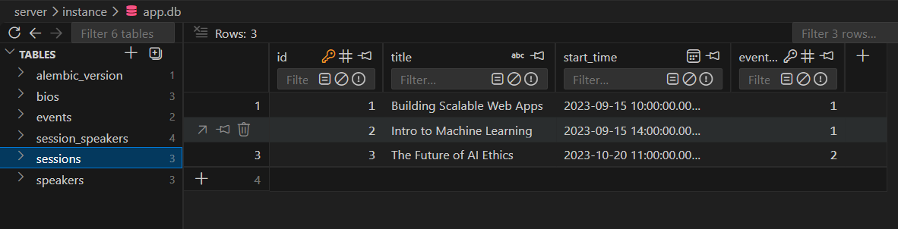

### Event Endpoints

#### Retrieve All Events

Demonstrates the `/events` endpoint, including nested session information.

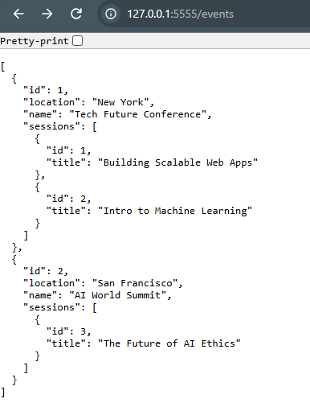

#### Retrieve Event Sessions

Demonstrates retrieving all sessions associated with a specific event.

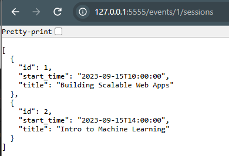

#### Event Not Found

Demonstrates the HTTP 404 response when the requested event does not exist.

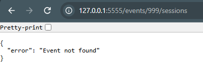

### Session Endpoints

#### Retrieve Session Speakers

Demonstrates retrieving all speakers associated with a session.

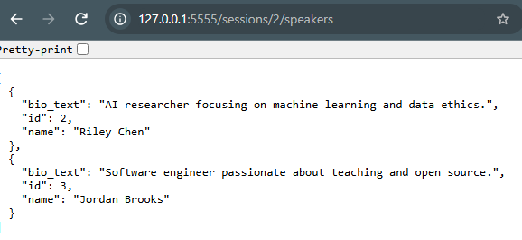

#### Session Not Found

Demonstrates the HTTP 404 response for an invalid session ID.

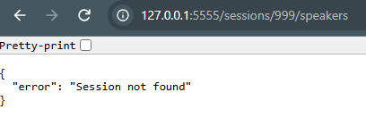

### Speaker Endpoints

#### Retrieve All Speakers

Demonstrates retrieving all speakers from the database.

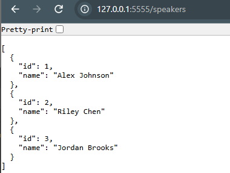

#### Retrieve Speaker Details

Demonstrates retrieving an individual speaker and their biography.

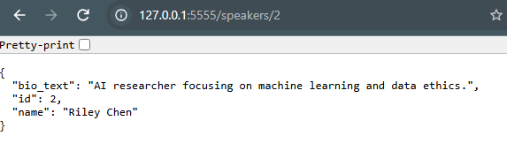

#### Retrieve Speaker Biography

Demonstrates accessing a speaker's biography through the one-to-one relationship.

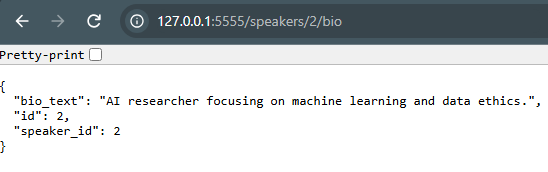

#### Retrieve Speaker Sessions

Demonstrates retrieving all sessions associated with a speaker.

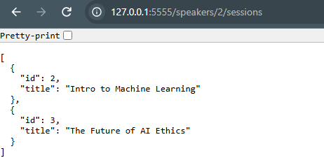

#### Speaker Not Found

Demonstrates the HTTP 404 response for an invalid speaker ID.

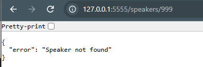

### Automated Testing

#### Pytest Test Suite

Displays the results of the automated test suite.

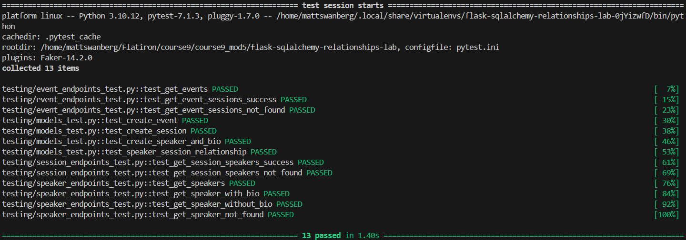

## Error Handling

The API returns appropriate HTTP status codes for successful and unsuccessful requests.

| Status Code | Description |
|---|---|
| 200 OK | Request completed successfully |
| 404 Not Found | Requested event, session, speaker, or biography does not exist |

Error responses use JSON dictionaries containing descriptive error messages.

## Database Migrations

Flask-Migrate and Alembic manage database schema changes.

### Generate a New Migration

After modifying database models:

```bash
flask db migrate -m "Description of changes"
```

### Apply Migrations

```bash
flask db upgrade head
```

### View Current Migration

```bash
flask db current
```

Migration files are stored in:

```text
server/migrations/versions/
```

This allows database schema changes to be tracked through version control.


## Author

Created by Matthew Swanberg as part of Course 9 Module 5 (Modeling Relationships in Flask-SQLAlchemy)